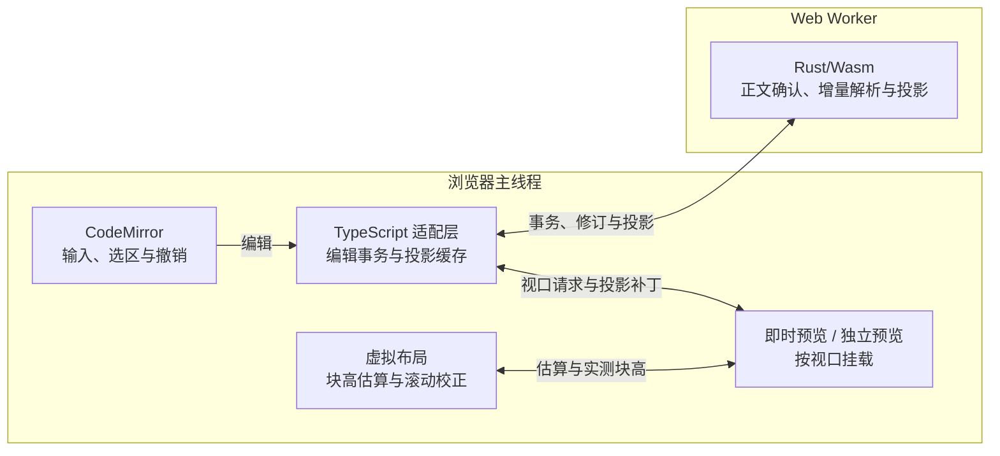
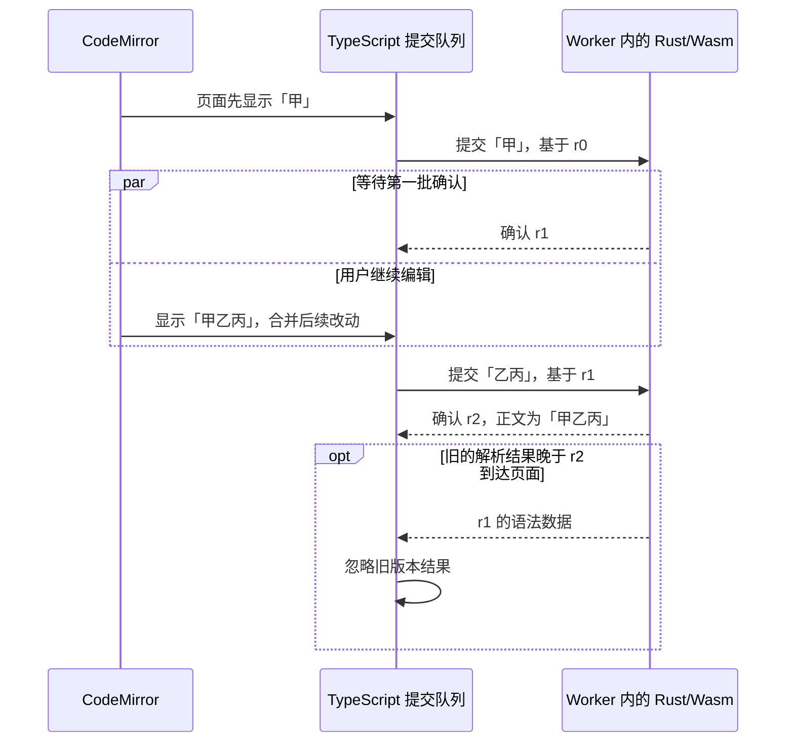

<p align="center">

</p>
<h1 align="center">Jot Markdown Engine</h1>
<p align="center">Rust/Wasm 驱动的可嵌入 Markdown 编辑器：支持即时预览与表格原位编辑，长文档按视口渲染。</p>
<p align="center">
<a href="https://lin037.github.io/jot-md-engine/"><strong>在线体验</strong></a> ·
<a href="packages/editor/README.md">组件接入</a> ·
<a href="docs/README.md">项目文档</a>
</p>
<p align="center">
<a href="https://github.com/lin037/jot-md-engine/actions/workflows/ci.yml"></a>
<a href="LICENSE"></a>
<a href="https://codemirror.net/"></a>
<a href="https://www.rust-lang.org/"></a>
<a href="https://wasm-bindgen.github.io/wasm-bindgen/"></a>
<a href="https://katex.org/"></a>
<a href="https://mermaid.js.org/"></a>
</p>

Jot 将前端交互与底层解析解耦：CodeMirror 6 在主线程负责输入、选区与撤销，Rust/Wasm 引擎在浏览器 Web Worker 中异步确认文本修订、增量解析语法并向视口投影所需内容。

* **三种编辑模式**：支持源码、即时预览与双栏编辑，最终保存输出始终为纯正 Markdown。

* **即时预览原位交互**：可直接修改正文、勾选任务列表或增删编辑表格单元格，并支持 KaTeX 数学公式与 Mermaid 图表（方言规则见[语法说明](docs/guides/markdown.md)）。

* **长文档虚拟布局**：按视口按需挂载并自动补偿滚动位置，减少大文档重排与加载跳屏。

* **键盘优先与命令面板**：命令面板集中提供格式、搜索、折叠和表格操作，常用操作支持纯键盘完成并可按宿主需求改键。

## 组件接入

在应用目录安装编辑器包：

```zsh
npm install https://github.com/lin037/jot-md-engine/releases/download/v0.1.0/jot-md-editor-0.1.0.tgz
```

主线程导入编辑器，模块 Worker 导入启动函数：

```ts
// src/main.ts
import { MarkdownEditor } from "@jot-md/editor";

// src/editor.worker.ts
import { bootstrapEditorWorker } from "@jot-md/editor/worker";
```

> 完整的挂载配置、Worker 绑定与读写保存示例见 [完整 Vite 接入示例](packages/editor/README.md#接入)。

## 编辑器架构

主线程里的 TypeScript 把 CodeMirror 的编辑提交给 Web Worker。Worker 用 TypeScript 调度 Rust/Wasm 引擎，返回正文修订和语法数据。编辑区可以先显示输入，预览随可用的语法数据更新。



### 编辑同步

以连续输入「甲乙丙」为例。CodeMirror 立即更新编辑区；第一批改动发出后，后续输入继续显示，同时合并到待提交的下一批。每批都附带它基于的修订号，Rust 引擎只接受基于当前修订的编辑。



主线程按请求号、事务号和修订号校验回包；后台解析更新的是语法和预览，旧修订的结果会被直接丢弃。收到确认前，`editor.value` 可能比 `editor.confirmedValue` 更新，保存时等待本轮输入提交后再读取已确认正文。提交失败会报错，连接仍有效时编辑区自动回退到最后一次确认的文本。[事务与错误处理](docs/architecture/editing-pipeline.md#编辑同步) · [保存方法](docs/guides/editor.md#保存和关闭)

### 虚拟布局

长文档的独立预览只挂载视口附近的内容。屏外的块尚未渲染，Jot 会先估算它们的高度以预留滚动空间：

* **用缓存字宽估算段落高度**：借鉴 Pretext 将文本测量与换行计算分开的思路，用 Canvas 测量并缓存字素宽度，再按容器宽度算出行数和段落高度；文本与字体相同时，调整容器宽度可直接复用字宽。图片按宽高比预留空间（尺寸未知时先用占位高度），长表格抽样估算行高后再按总行数计算高度。[Pretext 的测量方法](https://github.com/chenglou/pretext#api) · [Jot 的高度估算](packages/editor/src/layout/pretext/README.md)

* **缩小重排范围并补偿滚动**：独立预览用占位撑住屏外滚动空间，浏览器只排版已挂载块；通过块高累计索引直接定位滚动像素对应的块。块挂载后以实测高度替换估值——例如视口上方图片加载增高 40 px 时，自动补偿 40 px 滚动位置，避免正在阅读的段落跳动。[虚拟列表与滚动](docs/architecture/virtual-layout.md)

* **即时预览沿用 CodeMirror 行高**：普通文本、标题等仍由 CodeMirror 管理，仅对表格、块公式等替换源码行的部件补充初始高度；估算与显示共享行高、内边距等样式参数，减少挂载时的高度抖动。[即时预览的估算入口](packages/editor/src/hosts/live-preview/pretext-estimator.ts)

## 浏览器基准

在 **1 MiB 混合 Markdown 长文档**下：打开文档看到首帧变化 **14.8 ms**，输入单字响应 **12.2 ms**，滚动看到新内容 **20.8 ms**。

| 操作 | 看到变化 | 正文可以保存 | 可保存后到解析完 | 全文解析完成 |
| ----- | ----- | ----- | ----- | ----- |
| 打开文档 | 14.8 / 20.2 | 54.4 / 65.6 | 124.7 / 174.3 | 179.8 / 239.9 |
| 已有文档中输入一个汉字 | 12.2 / 16.8 | 16.3 / 17.5 | 0.0 / 0.0 | 16.3 / 17.5 |
| 在已有文档中滚动 | 20.8 / 22.4 | — | — | — |
| 一次输入整份文本 | 21.5 / 23.5 | 67.7 / 68.9 | 113.0 / 113.4 | 180.8 / 181.2 |
| 整份文本的粘贴事件 | 32.3 / 32.6 | 65.7 / 72.0 | 113.1 / 122.8 | 178.8 / 194.8 |
| 拖放整份文本 | 16.4 / 18.7 | 71.8 / 86.8 | 118.5 / 121.5 | 192.0 / 202.2 |
| 在已有 1 MiB 文档开头插入 1 MiB | 15.4 / 15.9 | 87.1 / 101.7 | 138.1 / 142.8 | 226.4 / 231.4 |

> 单位为毫秒，单元格为「中位数 / 最大值」（每一列单独统计）。运行 `pnpm run benchmark` 可在本机复测，详见[场景与计时方法](benchmarks/README.md)。

<details>
<summary>测试环境与计时口径说明</summary>

* **环境与样本**：Apple M3、macOS（Darwin 25.1.0）、Chrome 157.0.8103.79 无头模式，生产构建，1100 × 850 视口；样本为 1,048,985 字节混合 Markdown（约 1 MiB），每行 5 次测量，另有 1 次预热。

* **阶段定义**：「看到变化」「正文可以保存」「全文解析完成」分别记录从操作起点到对应时刻的用时。画面更新与正文提交可重叠，有时画面会晚于正文确认；「可保存后到解析完」只计后两者之间耗时，同时返回时记为 0。文件写入由宿主应用完成（见[保存方法](docs/guides/editor.md#保存和关闭)与[编辑流程细节](docs/architecture/editing-pipeline.md)）。

* **场景补充**：打开文档从创建编辑器起算；滚动只测看到新内容的用时；光标插入场景核对确认时取出的全文、Rust 独立快照及文件读回值；粘贴使用页面构造的剪贴板事件；拖放从事件送达编辑器计时（本轮自动化拖放命令往返中位数为 2.50 秒）。

</details>

## 本地开发与构建

需要 Node.js 22.13 或以上、pnpm 11.11.0 和 rustup。rustup 会按 `rust-toolchain.toml` 安装 Rust 1.100.0、格式化和静态检查组件以及 Wasm 编译目标；首次构建还需安装与 `Cargo.lock` 匹配的 `wasm-bindgen-cli`。

```zsh
git clone https://github.com/lin037/jot-md-engine.git
cd jot-md-engine
cargo install wasm-bindgen-cli --version 0.2.126 --locked
pnpm install --frozen-lockfile
pnpm run demo:dev
```

打开 `http://127.0.0.1:4173/` 后，可以先选「混合大文本」，试试从标题折叠一节、在表格里增删行列，再切回源码查看实际改动。开发命令会构建 release Wasm；构建静态站点请运行 `pnpm run demo:build`（产物在 `dist/demo/`），详见 [Demo 说明](apps/demo/README.md)。

从源码构建协议包与编辑器组件包，以及发包前验证：

```zsh
pnpm run build:editor    # 构建协议包与编辑器组件包
pnpm run package:verify  # 重新构建、打包并在空项目中安装验证产物
```

提交 Issue 和 PR 见[贡献指南](CONTRIBUTING.md)；npm 发布和 GitHub Pages 部署见[维护者手册](docs/contributing/releasing.md)。

## 文档与贡献

| 主题 | 入口 |
| ----- | ----- |
| 键位、编辑模式、主题和宿主配置 | [编辑器配置](docs/guides/editor.md) · [样式定制](docs/guides/theming.md) |
| 标题、表格、引用、公式与围栏的写法 | [Markdown 方言](docs/guides/markdown.md) |
| 从按键到 Rust 确认及虚拟渲染 | [技术文档](docs/README.md#理解实现) |
| 源码目录、测试命令、提交问题和 PR | [参与开发](CONTRIBUTING.md) · [源码目录与测试](docs/contributing/development.md) |
| 在本机测量编辑和滚动 | [基准测试](benchmarks/README.md) |

## 致谢

感谢 CodeMirror 和 Lezer 提供浏览器编辑基础，Rust 和 wasm-bindgen 让解析引擎可以在 Worker 中运行，也感谢 TypeScript、KaTeX 和 Mermaid 的维护者。

Pretext 将文本测量与按宽度排版分开，Jot 的离屏布局估算借鉴了这一思路。[Pretext](https://github.com/chenglou/pretext) · [Jot 的布局实现](docs/architecture/virtual-layout.md)

Jot 源码采用 MIT 许可证；随组件分发的第三方代码、公式样式与字体保留各自授权声明。[MIT 许可证](LICENSE) · [第三方声明](packages/editor/THIRD-PARTY-NOTICES.txt)