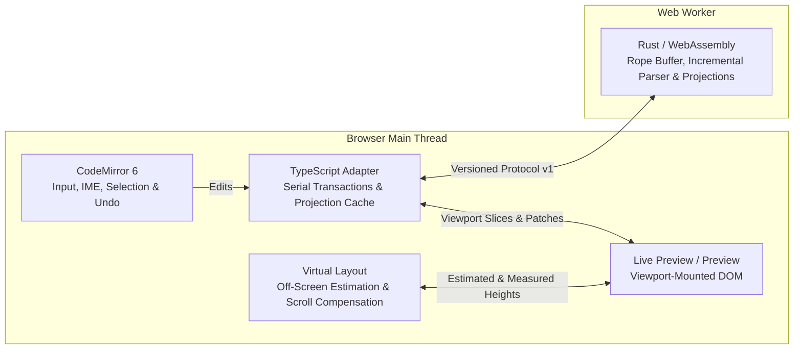

<p align="center">
  
</p>
<h1 align="center">Jot Markdown Engine</h1>
<p align="center">
  A Markdown editor you can embed in a web app. Edit in place, work with tables, and preview large documents.
</p>
<p align="center">
  <strong>English</strong> · <a href="README.zh-CN.md">简体中文</a>
</p>
<p align="center">
  <a href="https://lin037.github.io/jot-md-engine/"><strong>Live Demo</strong></a> ·
  <a href="packages/editor/README.md">Package Guide</a> ·
  <a href="docs/README.md">Documentation</a>
</p>
<p align="center">
  <a href="https://www.npmjs.com/package/@jot-md/editor"></a>
  <a href="https://github.com/lin037/jot-md-engine/actions/workflows/ci.yml"></a>
  <a href="LICENSE"></a>
  <a href="https://codemirror.net/"></a>
  <a href="https://www.rust-lang.org/"></a>
  <a href="https://wasm-bindgen.github.io/wasm-bindgen/"></a>
</p>

## What you can do

- Edit Markdown in place, or switch to source, a split view, or read-only preview.
- Check off tasks, edit tables, fold sections, and jump to headings.
- Work with large documents. The editor renders the area around the viewport and parses Markdown in a Worker.
- Customize shortcuts and colors, and choose the interface language.

## Quick Start

```sh
npm install @jot-md/editor
```

```ts
import { MarkdownEditor } from "@jot-md/editor";
```

See the [Package Guide](packages/editor/README.md#quick-start-vite--typescript) for a complete Vite example with the Worker and editor mounted together.

## Architecture Overview

Jot separates immediate user interaction from document parsing and virtualized layout:



- **Optimistic UI with revision-safe confirmation**: Local edits appear immediately in CodeMirror and are batched to the Worker with a base revision number. Outdated syntax or projection responses from older revisions are discarded automatically.
- **Viewport-scoped projections**: The Worker only serializes render nodes for the visible region (and requested table/code/quote windows), keeping memory and DOM size bounded even on huge files.

Learn more in [Editing Pipeline](docs/architecture/editing-pipeline.md), [Wire Protocol](docs/architecture/protocol.md), and [Virtual Layout](docs/architecture/virtual-layout.md).

## Browser Benchmarks

Measured on November 19, 2026 (UTC+8), in headless Chrome with a production build and a **1 MiB Markdown document**.

| Operation | Time to Visible Frame | Time to Confirmed Text | Full-Document Parse Complete |
| --- | ---: | ---: | ---: |
| Open document | 14.8 / 20.2 ms | 54.4 / 65.6 ms | 179.8 / 239.9 ms |
| Single character insert | 12.2 / 16.8 ms | 16.3 / 17.5 ms | 16.3 / 17.5 ms |
| Scroll to new region | 20.8 / 22.4 ms | — | — |
| Insert full 1 MiB payload | 21.5 / 23.5 ms | 67.7 / 68.9 ms | 180.8 / 181.2 ms |
| Paste full 1 MiB payload | 32.3 / 32.6 ms | 65.7 / 72.0 ms | 178.8 / 194.8 ms |
| Prepend 1 MiB into existing 1 MiB doc | 15.4 / 15.9 ms | 87.1 / 101.7 ms | 226.4 / 231.4 ms |

*Values are `median / max` in milliseconds across 5 measured runs (after 1 warmup). See [Benchmarks](benchmarks/README.md) for methodology and how to run them locally.*

<details>
<summary>Environment & timing definitions</summary>

- **Hardware & browser**: Apple M3, macOS (Darwin 25.1.0), Chrome 157.0.8103.79 headless, 1100 × 850 viewport, 1,048,985-byte mixed Markdown payload.
- **Visible Frame**: Time until the updated content appears in two consecutive rendered frames.
- **Confirmed Text**: Time until the Rust/Wasm Worker commits the revision and the host can safely read `editor.confirmedValue` for persistence.
- **Full-Document Parse Complete**: Time until background incremental syntax analysis finishes for the entire document.

</details>

## Documentation

| Topic | Guide |
| --- | --- |
| Package API, plugins, i18n, and bundling | [Package Guide](packages/editor/README.md) |
| Modes, shortcuts, tables, outline, and saving | [Editor Guide](docs/guides/editor.md) |
| Supported Markdown syntax and extensions | [Markdown Dialect](docs/guides/markdown.md) |
| CSS variables, layout metrics, and theming | [Theming & Layout](docs/guides/theming.md) |
| Pipeline, protocol, and virtual layout | [Architecture Docs](docs/README.md) |
| Local setup, tests, and pull requests | [Contributing Guide](CONTRIBUTING.md) · [Development Guide](docs/contributing/development.md) |

## Building from Source

Contributors working inside this monorepo need **Node.js >= 22.13**, **pnpm 11.11.0**, and **rustup** (which installs the pinned toolchain from `rust-toolchain.toml` and the `wasm32-unknown-unknown` target):

```sh
git clone https://github.com/lin037/jot-md-engine.git
cd jot-md-engine
cargo install wasm-bindgen-cli --version 0.2.126 --locked
pnpm install --frozen-lockfile
pnpm run demo:dev
```

Open `http://127.0.0.1:4173/` to run the interactive demo locally.

To build and verify the publishable npm package locally:

```sh
pnpm run build:editor
pnpm run package:verify
```

## Acknowledgments & License

Jot builds on [CodeMirror 6](https://codemirror.net/), [Lezer](https://lezer.codemirror.net/), [Rust](https://www.rust-lang.org/), [wasm-bindgen](https://wasm-bindgen.github.io/wasm-bindgen/), [KaTeX](https://katex.org/), [Mermaid](https://mermaid.js.org/), and [Tabler Icons](https://tabler.io/icons). Its off-screen text layout estimation draws inspiration from [Pretext](https://github.com/chenglou/pretext).

Licensed under the [MIT License](LICENSE). Bundled third-party fonts, stylesheets, and crate notices are listed in [THIRD-PARTY-NOTICES.txt](packages/editor/THIRD-PARTY-NOTICES.txt).
