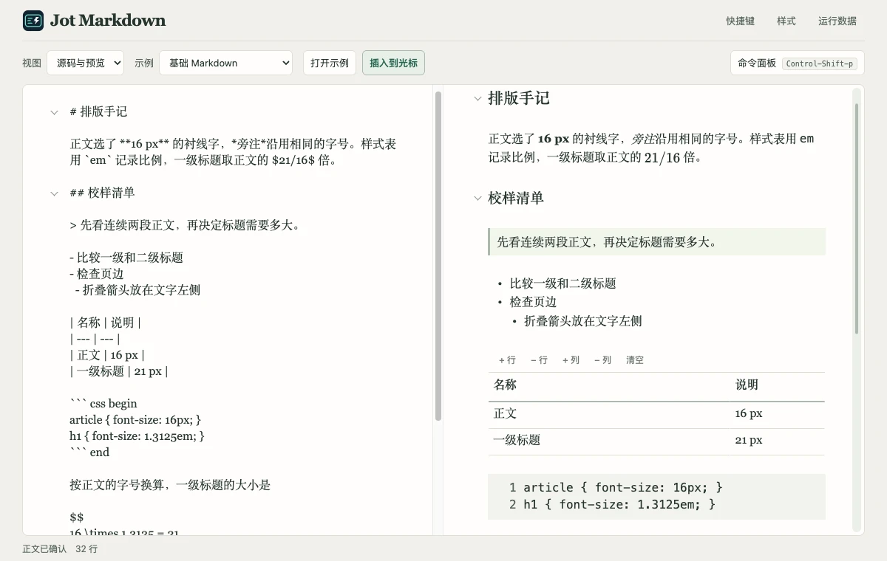
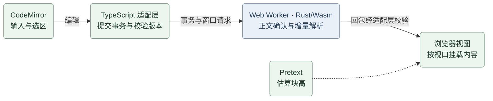
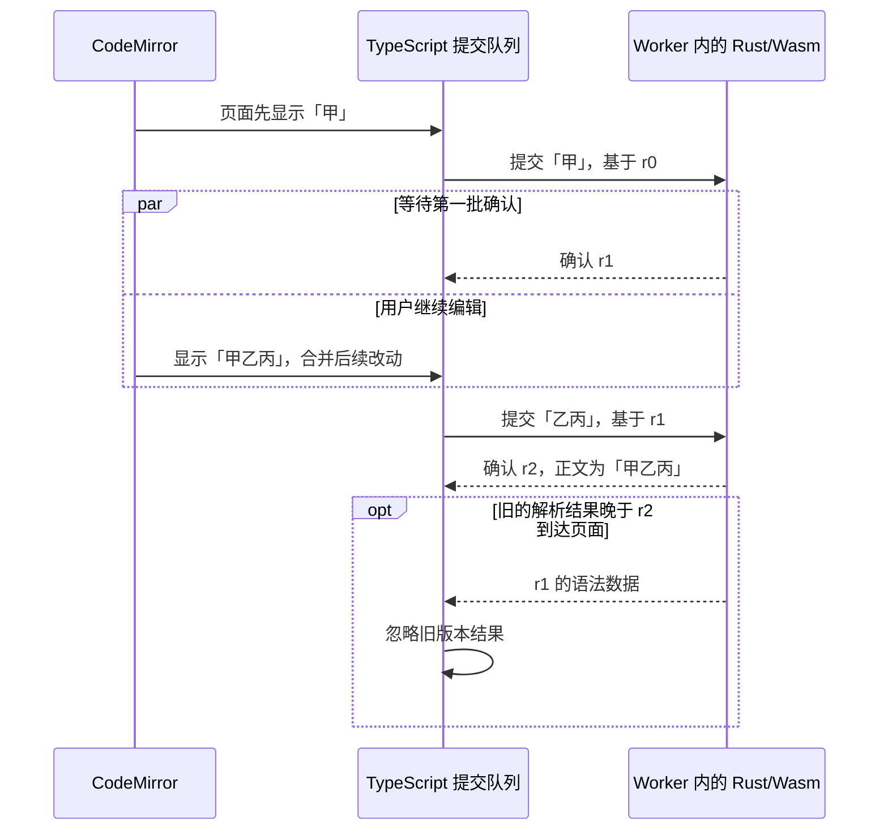

<p align="center">
  
</p>
<h1 align="center">Jot Markdown Engine</h1>
<p align="center">可嵌入网页的 Markdown 编辑器，由 CodeMirror 6 和 Rust/Wasm 驱动。</p>
<p align="center">
  <a href="https://blog.lin037.cn/jot-md-engine/"><strong>在线 Demo</strong></a> ·
  <a href="packages/editor/README.md">组件接入</a> ·
  <a href="docs/README.md">项目文档</a>
</p>
<p align="center">
  <a href="https://github.com/lin037/jot-md-engine/actions/workflows/ci.yml"></a>
  <a href="LICENSE"></a>
</p>
<p align="center">
  <a href="https://blog.lin037.cn/jot-md-engine/"></a>
</p>

Jot 支持源码、即时预览和双栏编辑。在即时预览里可以直接改正文、勾选任务或编辑表格单元格，保存的内容仍是 Markdown。命令面板提供格式、搜索、折叠和表格操作，常用操作支持键盘和自定义快捷键。[Markdown 方言](docs/guides/markdown.md)

## 本地演示

从仓库根目录运行。需要 Node.js 22.13 或以上、pnpm 11.11.0 和 rustup。rustup 会按 `rust-toolchain.toml` 安装 Rust 1.100.0、格式化和静态检查组件，以及 Wasm 编译目标。首次构建还需要安装与 `Cargo.lock` 匹配的 `wasm-bindgen-cli`。

```sh
cargo install wasm-bindgen-cli --version 0.2.126 --locked
pnpm install --frozen-lockfile
pnpm run demo:dev
```

打开 `http://127.0.0.1:4173/`。可以先选“混合大文本”，试试从标题折叠一节、在表格里增删行列，再切换到源码看实际改动。开发命令会构建 release Wasm。构建静态站点用 `pnpm run demo:build`，产物在 `dist/demo/`。[Demo 说明](apps/demo/README.md)

## 组件接入

`@jot-md/editor` 提供编辑器、Worker 启动函数和配套 Wasm。宿主负责创建容器与模块 Worker，并选择何时读取和保存文档。组件包的 README 给出了主线程和 Worker 的完整接入示例。[组件接入](packages/editor/README.md)

从源码构建协议包和编辑器组件包时，在仓库根目录运行以下命令。

```sh
pnpm run build:editor
```

准备分发时可单独运行 `pnpm run package:verify`。它会重新构建、打包，再在一个空项目里安装并验证产物。

提交 Issue 和 PR 见[贡献指南](CONTRIBUTING.md)。npm 发布和 GitHub Pages 部署见[维护者手册](docs/contributing/releasing.md)。

## 编辑器架构

CodeMirror 在主线程处理输入。TypeScript 适配层把编辑发给 Web Worker，Rust/Wasm 在 Worker 内确认文本并增量解析。主线程校验回包的修订号，再更新当前视口。



基准测量记录三个时点。**A** 是页面看到变化，**B** 是 Worker 确认正文、应用可以保存，**C** 是该修订的全文解析完成。

### 编辑同步

以连续输入「甲乙丙」为例。CodeMirror 立即更新编辑区。第一批改动发出后，后续输入继续显示，同时合并到待提交的下一批。每批都带着它基于的修订号，Rust 只接受基于当前修订的编辑。



主线程按请求号、事务号和修订号确认回包。后台解析更新的是语法和预览，旧修订的结果会被丢弃。收到确认前，`editor.value` 可能比 `editor.confirmedValue` 更新。保存时等本轮输入提交，再读取已确认正文。提交失败会报错，连接仍有效时编辑区会回到最后一次确认的文本。[事务与错误处理](docs/architecture/editing-pipeline.md#编辑同步) · [保存方法](docs/guides/editor.md#保存和关闭)

### 虚拟布局

- **先测字宽，再算换行。** Jot 借鉴 Pretext 的两步做法。先用 Canvas 测量并缓存字素宽度，再按可用宽度算会换成几行。文本和字体相同时，宽度变化可以沿用这些测量值。普通段落用「换行后的行数 × 行高」计算文字高度，再按块计入边框和间距。图片按宽高比留位置，尺寸未知时先用占位高度。长表格抽样估算行高，再按总行数算高度。[Pretext 的测量方法](https://github.com/chenglou/pretext#api) · [Jot 的高度估算](packages/editor/src/layout/pretext/README.md)
- **缩小浏览器需要重排的范围。** 独立预览用占位撑住屏外内容的滚动空间，浏览器只排版已挂载的块。块高的累计值有索引，滚动到某个像素位置时可以直接找对应块。块挂载后用实测高度替换估值。比如一张仍挂载在视口上方的图片在加载后增高了 40 px，滚动位置可随之补偿 40 px，让正在看的段落留在原处。[虚拟列表与滚动](docs/architecture/virtual-layout.md)
- **即时预览沿用 CodeMirror 的行高。** 普通文本、标题等仍由 CodeMirror 管理，表格、块公式这类会替换源码行的部件才补初始高度。估算和显示共享行高、内边距等样式参数，减少内容挂载时的高度变化。[即时预览的估算入口](packages/editor/src/hosts/live-preview/pretext-estimator.ts)

## 浏览器基准

「看到变化」「正文可以保存」「全文解析完成」分别从操作起点计到 A、B、C。画面更新和正文提交可以重叠，A 有时会晚于 B。「可保存后到解析完」只算 B 到 C，两项结果一起返回时记为 0。文件写入由接入编辑器的应用完成。[保存方法](docs/guides/editor.md#保存和关闭) · [编辑流程细节](docs/architecture/editing-pipeline.md)

在 Apple M3、macOS（Darwin 25.1.0）、Chrome 157.0.8103.79 无头模式下，使用生产构建和 1100 × 850 视口。样本为 1,048,985 字节混合 Markdown，约 1 MiB。每行 5 次测量，另有 1 次预热。单位为毫秒，单元格写中位数 / 最大值。

| 操作 | 看到变化 | 正文可以保存 | 可保存后到解析完 | 全文解析完成 |
| --- | ---: | ---: | ---: | ---: |
| 打开文档 | 14.8 / 20.2 | 54.4 / 65.6 | 124.7 / 174.3 | 179.8 / 239.9 |
| 已有文档中输入一个汉字 | 12.2 / 16.8 | 16.3 / 17.5 | 0.0 / 0.0 | 16.3 / 17.5 |
| 在已有文档中滚动 | 20.8 / 22.4 | — | — | — |
| 一次输入整份文本 | 21.5 / 23.5 | 67.7 / 68.9 | 113.0 / 113.4 | 180.8 / 181.2 |
| 整份文本的粘贴事件 | 32.3 / 32.6 | 65.7 / 72.0 | 113.1 / 122.8 | 178.8 / 194.8 |
| 拖放整份文本 | 16.4 / 18.7 | 71.8 / 86.8 | 118.5 / 121.5 | 192.0 / 202.2 |
| 在已有 1 MiB 文档开头插入 1 MiB | 15.4 / 15.9 | 87.1 / 101.7 | 138.1 / 142.8 | 226.4 / 231.4 |

打开文档从创建编辑器起算。滚动只测看到新内容的用时。每一列单独统计中位数和最大值。

光标插入场景还核对确认时取出的全文、Rust 独立快照及文件读回值。粘贴使用页面构造的剪贴板事件。拖放从事件送达编辑器计时，本轮自动化拖放命令往返中位数为 2.50 秒。运行 `pnpm run benchmark` 可复测。[场景与计时方法](benchmarks/README.md)

## 文档与贡献

| 主题 | 入口 |
| --- | --- |
| 键位、编辑模式、主题和宿主配置 | [编辑器配置](docs/guides/editor.md) · [样式定制](docs/guides/theming.md) |
| 标题、表格、引用、公式与围栏的写法 | [Markdown 方言](docs/guides/markdown.md) |
| 从按键到 Rust 确认及虚拟渲染 | [技术文档](docs/README.md#理解实现) |
| 源码目录、测试命令、提交问题和 PR | [参与开发](CONTRIBUTING.md) · [源码目录与测试](docs/contributing/development.md) |
| 在本机测量编辑和滚动 | [基准测试](benchmarks/README.md) |

## 致谢

感谢 CodeMirror 和 Lezer 提供浏览器编辑基础，Rust 和 wasm-bindgen 让解析引擎可以在 Worker 中运行。也感谢 TypeScript、KaTeX 和 Mermaid 的维护者。

Pretext 把文本测量与按宽度排版分开。Jot 的离屏布局估算借鉴了这个思路。[Pretext](https://github.com/chenglou/pretext) · [Jot 的布局实现](docs/architecture/virtual-layout.md)

Jot 源码使用 MIT 许可证。随组件分发的第三方代码、公式样式和字体保留各自的授权声明。[MIT 许可证](LICENSE) · [第三方声明](packages/editor/THIRD-PARTY-NOTICES.txt)
