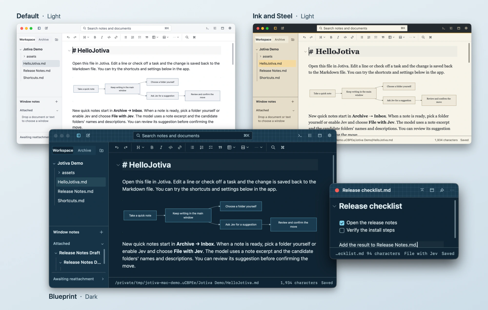
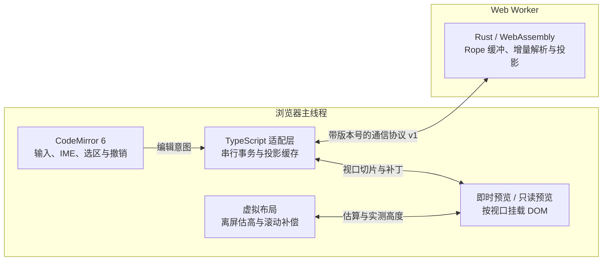

<p align="center">
  
</p>
<h1 align="center">Jot Markdown Engine</h1>
<p align="center">
  可以嵌入网页的 Markdown 编辑器。支持在预览里编辑正文、操作表格和浏览长文档。
</p>
<p align="center">
  <a href="README.md">English</a> · <strong>简体中文</strong>
</p>
<p align="center">
  <a href="https://lin037.github.io/jot-md-engine/"><strong>在线体验</strong></a> ·
  <a href="docs/zh-CN/guides/package.md">组件接入指南</a> ·
  <a href="docs/zh-CN/README.md">完整文档</a>
</p>
<p align="center">
  <a href="https://www.npmjs.com/package/@jot-md/editor"></a>
  <a href="https://github.com/lin037/jot-md-engine/actions/workflows/ci.yml"></a>
  <a href="LICENSE"></a>
  <a href="https://codemirror.net/"></a>
  <a href="https://www.rust-lang.org/"></a>
  <a href="https://wasm-bindgen.github.io/wasm-bindgen/"></a>
</p>

## 可以用它做什么

- 直接在预览里编辑 Markdown，也可以切到源码、双栏对照或只读预览。
- 勾选任务、编辑表格、折叠章节，用大纲跳到想看的标题。
- 编辑长文档时，页面只渲染视口附近的内容，Markdown 在 Worker 里解析。
- 按需要调整快捷键、颜色和界面语言。

## 快速开始

```sh
npm install @jot-md/editor
```

```ts
import { MarkdownEditor } from "@jot-md/editor";
```

[组件接入指南](docs/zh-CN/guides/package.md#快速开始vite--typescript)里有完整的 Vite 示例，从创建 Worker 到挂载编辑器都可以照着做。

桌面 Markdown 编辑器 [Jotiva](https://github.com/lin037/jotiva) 使用了这个组件。想看实际项目怎么接入，可以直接读它的[编辑器接入代码](https://github.com/lin037/jotiva/blob/main/src/editor/note-editor.ts)。

[](https://github.com/lin037/jotiva)

## 架构概览

Jot 将前端即时交互与底层文档解析、视口虚拟布局清晰解耦：



- **乐观更新与修订校验**：编辑内容会立即在 CodeMirror 中显示，并附带基准修订号批量发送至 Worker。后台若返回过期修订号的解析或投影结果，主线程会自动丢弃，确保视图与当前文本一致。
- **按视口按需投影**：Worker 仅序列化当前可见窗口（及按需展开的表格、代码块或引用片段）所需的渲染节点，即使打开数兆字节的长文档，内存与 DOM 节点数依然可控。

更多实现细节见 [编辑管线](docs/zh-CN/architecture/editing-pipeline.md)、[通信协议](docs/zh-CN/architecture/protocol.md) 与 [虚拟布局](docs/zh-CN/architecture/virtual-layout.md)。

## 浏览器性能基准

测试于 2026 年 11 月 29 日（UTC+8）进行，使用 Chrome 无头模式、生产构建和约 **1 MiB 的 Markdown 文档**。

| 操作场景 | 画面首次可见 | 正文确认可保存 | 全文解析完成 |
| --- | ---: | ---: | ---: |
| 打开文档 | 17.6 / 29.9 ms | 71.4 / 112.7 ms | 241.2 / 323.2 ms |
| 输入单字 | 12.6 / 14.2 ms | 18.2 / 24.4 ms | 18.2 / 24.4 ms |
| 滚动到新区域 | 23.1 / 24.7 ms | — | — |
| 在段落内粘贴短文本 | 12.8 / 14.0 ms | 15.6 / 21.0 ms | 15.6 / 21.0 ms |
| 查找到文末匹配 | 83.2 / 146.1 ms | — | — |
| 撤销段内编辑 | 15.6 / 17.9 ms | 8.8 / 22.5 ms | 8.8 / 22.5 ms |
| 重做段内编辑 | 15.9 / 21.4 ms | 8.1 / 22.3 ms | 8.1 / 22.3 ms |
| 一次性插入整份 1 MiB 文本 | 22.3 / 24.3 ms | 68.8 / 110.4 ms | 202.9 / 361.2 ms |
| 整份 1 MiB 文本粘贴事件 | 31.7 / 32.8 ms | 67.2 / 109.2 ms | 193.5 / 334.5 ms |
| 在已有 1 MiB 文档开头再插入 1 MiB | 20.0 / 27.4 ms | 110.6 / 139.7 ms | 283.5 / 361.8 ms |

*单元格格式为「中位数 / 最大值」，单位为毫秒。共测两轮，每轮预热 1 次、采样 5 次。测试方法与复测命令见 [性能基准说明](benchmarks/README.zh-CN.md)。*

<details>
<summary>测试环境与指标口径说明</summary>

- **运行环境**：Apple M3、macOS（Darwin 25.1.0）、Chrome 158.0.8127.37 无头模式、1100 × 850 视口，测试样本为 1,048,985 字节的混合 Markdown。
- **画面首次可见**：从操作触发到页面连续两帧呈现目标内容的时间。
- **正文确认可保存**：从操作触发到 Rust/Wasm Worker 确认修订、宿主可安全读取 `editor.confirmedValue` 的时间。
- **全文解析完成**：后台增量语法分析覆盖完整文档的时间。

</details>

## 文档导航

| 主题 | 文档入口 |
| --- | --- |
| 组件 API、插件、国际化与打包 | [组件接入指南](docs/zh-CN/guides/package.md) |
| 编辑模式、快捷键、表格、大纲与保存 | [编辑器配置与交互](docs/zh-CN/guides/editor.md) |
| 支持的 Markdown 语法与扩展规则 | [Markdown 方言说明](docs/zh-CN/guides/markdown.md) |
| CSS 变量、排版指标与样式定制 | [主题与布局定制](docs/zh-CN/guides/theming.md) |
| 编辑管线、通信协议与虚拟布局 | [技术文档目录](docs/zh-CN/README.md) |
| 参与贡献、本地开发与测试 | [贡献指南](CONTRIBUTING.zh-CN.md) · [开发与测试指南](docs/zh-CN/contributing/development.md) |

## 从源码构建

如需参与本项目开发或本地构建产物，请准备 **Node.js >= 22.13**、**pnpm 11.11.0** 和 **rustup**（自动安装 `rust-toolchain.toml` 指定的 Rust 工具链及 `wasm32-unknown-unknown` 目标）：

```sh
git clone https://github.com/lin037/jot-md-engine.git
cd jot-md-engine
cargo install wasm-bindgen-cli --version 0.2.126 --locked
pnpm install --frozen-lockfile
pnpm run demo:dev
```

启动后访问 `http://127.0.0.1:4173/` 即可本地体验交互式 Demo。

从源码构建可发布的 npm 组件包并运行独立安装校验：

```sh
pnpm run build:editor
pnpm run package:verify
```

## 致谢与许可证

感谢 [CodeMirror 6](https://codemirror.net/)、[Lezer](https://lezer.codemirror.net/)、[Rust](https://www.rust-lang.org/)、[wasm-bindgen](https://wasm-bindgen.github.io/wasm-bindgen/)、[KaTeX](https://katex.org/)、[Mermaid](https://mermaid.js.org/) 和 [Tabler Icons](https://tabler.io/icons) 等开源项目。Jot 的离屏排版估算思路借鉴了 [Pretext](https://github.com/chenglou/pretext)。

本项目源码采用 [MIT 许可证](LICENSE)；随发布包分发的第三方字体、样式与依赖声明见 [THIRD-PARTY-NOTICES.txt](packages/editor/THIRD-PARTY-NOTICES.txt)。
